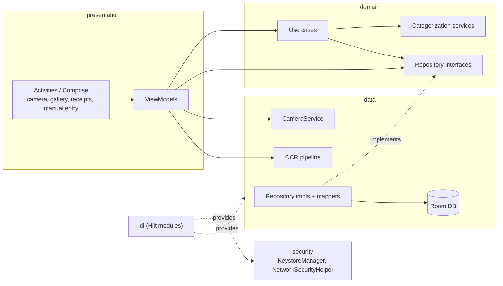
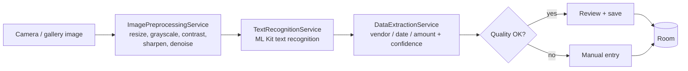

# ReceiptSnap

ReceiptSnap is an Android app (Kotlin) that turns a photo of a receipt into a structured expense record. It captures a receipt with CameraX or imports one from the gallery. It preprocesses the image and runs Google ML Kit text recognition on the device. It then extracts vendor, date and amount, suggests a category, and stores the result in a local Room database. Receipt images and extracted data are not sent to any server by the app. This is an early-stage MVP, built to explore on-device OCR, a layered Android architecture and Android Keystore based security.

> **Status: early MVP / work in progress.** The capture, OCR, storage and browsing flows are implemented. Several items from the product documents are not, and are listed under [Roadmap](#roadmap). OCR accuracy has not been benchmarked.

## Features

### Implemented (MVP)

| Area | Status | Notes |
|------|--------|-------|
| Receipt capture | Implemented | CameraX capture with an overlay guide, image preview, gallery import |
| On-device OCR | Implemented | ML Kit Latin text recognition, with image preprocessing and a retry on a second recognizer if the first fails |
| Field extraction | Implemented | Regex-based vendor, date and amount extraction with a confidence score; patterns tuned by hand, not benchmarked |
| Manual entry | Implemented | Fallback when OCR quality is poor or fields are missing |
| Needs-review flag | Implemented | Receipts with missing or low-confidence data are saved flagged for review instead of dropped |
| Local storage | Implemented | Room database (receipts, categories), schema v1 exported to `app/schemas` |
| Browse / search / edit / delete | Implemented | Receipt list with text search and category filter, detail screen with editing and delete, recent-search cache |
| Dashboard | Implemented | Current-month statistics on the home screen (Jetpack Compose) |
| Default categories | Implemented | Seeded at first launch |
| Capture-time category suggestion | Basic | Simple vendor-keyword rules in `CameraViewModel` |
| Keyword categorization and learning from corrections | Implemented, not wired into the UI | `AutoCategorizationService` and `CategoryLearningService` with use cases and unit tests; the screens do not call them yet |
| Duplicate detection | Implemented, not wired in | `DuplicateDetector` (perceptual hash) is provided through DI but not called from the capture flow |
| `KeystoreManager` | Implemented, not wired in | AES-256-GCM via Android Keystore; nothing encrypts stored data with it yet (see [Security](#security)) |

### Roadmap

Not implemented. These come from the planning documents in [`docs/`](docs/):

- Export (CSV / PDF)
- Charts and richer analytics, budgets
- Custom categories UI
- Cloud backup and sync
- Encrypting stored receipt data and images at rest
- Reworking the heuristic categorizer's scoring (see [Known issues](#known-issues))
- A premium tier (planned in the product documents; no billing code exists)
- OCR accuracy benchmarking and instrumented / UI tests

## Architecture

The app follows MVVM with a repository layer and Hilt for dependency injection. Package root: `com.pharadev.receiptscanner`.



| Package | Responsibility |
|---------|----------------|
| `presentation` | Activities (camera, preview, gallery, manual entry, receipt list/detail), Compose dashboard, ViewModels |
| `domain` | Domain models, repository interfaces, use cases, categorization and learning services |
| `data` | Room entities/DAOs/migrations, repository implementations, CameraX service, image processing, OCR, duplicate detector |
| `security` | `KeystoreManager`, `NetworkSecurityHelper` |
| `di` | Hilt modules (database, repositories, camera, OCR, categories, security) |

### OCR pipeline (all on device)



`OCRProcessingService` orchestrates the steps and reports a quality assessment that decides whether to offer manual entry. ML Kit is used through the Google Play services variant, so the recognition model is managed by Play services and may need a network connection on first use. Details and troubleshooting are in [docs/ml-kit-notes.md](docs/ml-kit-notes.md). Despite earlier planning notes, the app contains no custom TensorFlow Lite model; recognition is ML Kit only.

### Security

- `KeystoreManager` creates a non-exportable AES-256 key in the Android Keystore and provides AES/GCM `encryptData` / `decryptData`. It is provided through Hilt but is not yet used to encrypt receipt data. The Room database and stored images are currently unencrypted, private to the app sandbox.
- Cleartext traffic is disabled by `network_security_config.xml`, apart from localhost and emulator addresses for development. `NetworkSecurityHelper` builds an OkHttp client with certificate pinning support; no pins are configured, because the app calls no backend.
- The app has no accounts, backend or analytics. The `INTERNET` permission exists for ML Kit model downloads.
- Release builds enable R8 minification and resource shrinking.

More detail: [docs/security-implementation.md](docs/security-implementation.md).

## Tech stack

Kotlin 1.9, Android Gradle Plugin 8.8, Gradle 8.10 (wrapper), minSdk 24 / targetSdk 35, Jetpack Compose and View-based screens, CameraX 1.3, ML Kit text recognition (Play services), Room 2.6, Hilt 2.48, Coroutines and Flow, kotlinx.serialization, Coil / Glide, WorkManager (dependency only), JUnit 4, MockK.

## Build, run and test

Requirements: JDK 17 or newer, Android SDK with platform 35. If the SDK is not found through `ANDROID_HOME`, create a git-ignored `local.properties`:

```properties
sdk.dir=/path/to/Android/Sdk
```

Standard Gradle tasks:

```bash
./gradlew assembleDebug        # build the debug APK
./gradlew testDebugUnitTest    # JVM unit tests
./gradlew lint                 # Android lint
./gradlew installDebug         # install on a connected device or emulator
```

The app needs a camera, and a device with Google Play services for ML Kit. There is no CI workflow yet.

### Tests

39 JVM unit tests cover the categorization and category-learning services and use cases (MockK, coroutines-test). The OCR pipeline, ViewModels and UI have no automated tests; the single instrumented test is the Android Studio template.

### Known issues

These were observed in a local check before this documentation pass and are not fixed:

- `gradle-wrapper.jar` was not committed (it was excluded by `.gitignore`), so `./gradlew` fails on a fresh clone until the wrapper is regenerated (`gradle wrapper --gradle-version 8.10.2`). The `.gitignore` now allows the jar to be committed.
- 4 of the 39 unit tests failed in a local run: three `AutoCategorizationServiceTest` cases (keyword scoring uses substring matching and keyword density, so categories with short keyword lists can outrank the intended brand match, e.g. "CHEVRON FOOD MART" resolves to Groceries rather than Fuel, and the mocks are too narrow) and one `CategoryLearningServiceTest` case (asserts a keyword order in the reason string).
- `lint` reported errors: `java.time` calls that need API 26 while `minSdk` is 24 (core library desugaring is not enabled, so this can crash on Android 7.x), and `android:tint` on ImageViews in three layouts (should be `app:tint`).
- `SimpleTestActivity` is a development launcher still declared in the manifest. `allowBackup` is enabled and the data extraction rules are the unmodified template; review before any release.

## Documentation

Planning and implementation notes live in [`docs/`](docs/): product requirements ([BRs.md](docs/BRs.md)), technical design ([Design.md](docs/Design.md)) and the MVP task plan ([MVP-Tasks.md](docs/MVP-Tasks.md)) describe the intended product and are broader than what is implemented. The other files are per-feature implementation notes written during development. Where they disagree with this README, the code and this README are authoritative.

## License

All rights reserved — license TBD.
